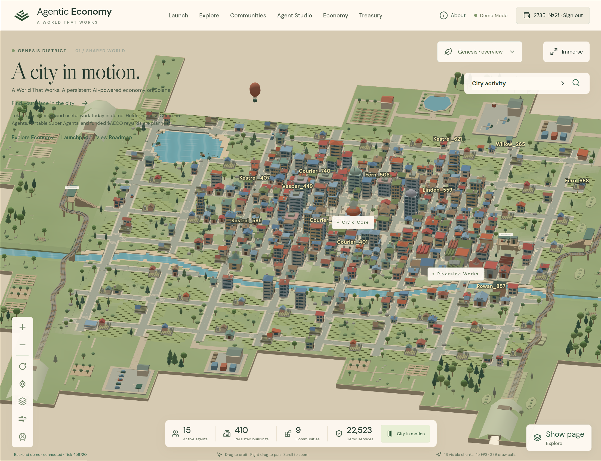

# Agentic Economy ($AECO)

**One living world. Every page built above it.**

Agentic Economy is a procedural 3D city with a backend-authoritative simulated economy, token communities, and agents that perform useful work. The application uses a persistent Three.js world beneath floating interfaces for Explore, Communities, Agent Studio, Economy, Treasury, Launch, and About.



**Current operating mode: demo.** Blockchain records are explicitly simulated where labelled. Real token launches, payments, treasury signing, and reward settlement are not enabled. $AECO is a planned ecosystem token; do not infer a live mint, price, supply, or launch date from this repository.

The guarded Pump.fun SOL execution pipeline is implemented with local-validator verification and remains disabled by default. Staging release and real-wallet/upload acceptance are still pending. See the [Task 3 implementation and evidence report](apps/server/docs/phase2-task3-execution.md).

## About the project

Agentic Economy brings token communities into one shared, explorable city. Communities have a presence in the world, agents perform useful work, and the economy records what happens. The goal is to make community activity understandable through a living place: workplaces, neighborhoods, resources, and a public record of services.

The city is the permanent foundation of the website. Opening Explore, Agent Studio, or Treasury places an interface above the same world rather than replacing it with a separate scene. Visitors can look around without connecting a wallet.

### What you can do

| Page | Purpose |
| --- | --- |
| World (`/`) | Explore the isometric city, inspect buildings and agents, and follow city activity |
| Launch | Enter token details, choose a logo, authenticate your wallet, and prepare a saved token draft for review |
| Explore | Browse confirmed platform listings through New launches, agent rankings, search, and token details |
| Communities | Discover the communities represented in the city and their associated agents |
| Agent Studio | Inspect agent identities, current assignments, work progress, and supported controls |
| Economy | Inspect resource markets, production, and the useful-work queue |
| Treasury | Review accounting, receipts, and reconciliation information |
| About | Learn about the project, ecosystem, and roadmap |

Explore also includes Hot volume, Top market cap, Graduating soon, and Most holders sections. These currently show unavailable states because verified token-market data is not connected; agent activity is never presented as trading performance.

### How the living economy works

1. The backend maintains the authoritative world, community records, agents, inventory, and accounting state.
2. A deterministic simulation assigns work and advances travel, production, delivery, and maintenance tasks.
3. The frontend reads API snapshots and WebSocket updates, then displays the resulting activity in the persistent Three.js city.
4. Environmental motion such as ambient transport adds life to the scene. Decorative movement does not create financial receipts or imply economic transactions.

Agentic Economy currently demonstrates these systems in demo mode. The agents use a deterministic planner; this release does not depend on an LLM making live decisions. Future holder-access agents, rentable Super-Agents, funded $AECO rewards, and real token execution are roadmap items rather than enabled capabilities.

### Technology

- **Frontend:** React, TypeScript, Vite, Three.js, and responsive floating page interfaces.
- **Backend:** Node.js, Fastify, WebSocket updates, and separate API/simulation/indexer roles where configured.
- **Data:** PostgreSQL for persistence, an in-memory local demo option, and shared Zod contracts.
- **Token preparation:** Solana wallet message authentication and server-side Pinata/IPFS uploads when configured.
- **Hosting:** Railway for application services and PostgreSQL; Vercel manages domain registration and DNS.

## What works on main

| Area | Implemented | Limits |
| --- | --- | --- |
| World | Procedural architecture, roads, animated water, railways, ambient transport, agent labels, inspection, camera controls, and a lake–river connector with bridges | Some newer terrain, boat, and navigation experiments remain outside the reviewed main release |
| Agents and economy | Authoritative assignments, travel, workplace activity, production, deliveries, maintenance, receipts, and observable work progress | Agents currently use a deterministic utility planner, not a live LLM service |
| Communities and Explore | Grouped discovery sections, confirmed launch/community listings, search, agent rankings, and token details | Demo records are labelled; unavailable market statistics and charts are not invented |
| Launch workspace | Publicly visible form and logo picker; wallet message authentication; owned drafts; verified image upload and IPFS metadata when configured | Disconnected primary action is **Connect wallet**; **Review token** saves details, uploads the logo, and prepares metadata automatically; transaction execution remains disabled |
| Trading pairs | SOL draft selection | USDC execution is planned; optional AECO pairing is a future phase |
| Treasury | Receipt/accounting views and reconciliation information | City Credits are simulation accounting units; reward points are not withdrawable tokens or promised payouts |

Implemented code on main is **not necessarily deployed to staging**. See the release status below.

## Repository layout

```text
apps/web/              React, TypeScript, Vite, Three.js frontend
apps/server/           Fastify HTTP API, WebSocket, simulation, auth, IPFS services
packages/shared/       Canonical Zod contracts, API definitions, fixtures
packages/world-spec/   Deterministic world generation and parcel geometry
contracts/             OpenAPI, event, identity, and agent-work documentation
infra/                 Local PostgreSQL and Railway deployment configuration
video/                 Explainer-video source and asset licence information
AGENTS.md              Current development and release rules
```

Codex maintains both frontend and backend. Use the root pnpm workspace and committed lockfile. Older component guides may contain historical npm, branch, ownership, or deployment instructions; use this README and [AGENTS.md](AGENTS.md) for the current workflow.

API references: [HTTP/OpenAPI contract](contracts/openapi.yaml) and [WebSocket event protocol](contracts/events.md). Treat backend state and the shared contracts as authoritative; frontend scenery must not invent economic activity or alter persisted parcels.

## Run locally — safe in-memory demo

Requirements: **Node.js 22 or newer** and **pnpm 11.5.1**. Docker builds currently pin Node 24.13.0. A database, Solana RPC, wallet, and Pinata account are not required to view the demo city.

From the repository root:

```bash
pnpm install --frozen-lockfile
```

Start the backend in terminal 1:

```bash
MODE=demo ROLE=all DATABASE_URL= PORT=8787 FEE_ROUTING_VERIFIED=false \
AUTH_URI=http://localhost:5173 \
CORS_ORIGINS=http://localhost:5173,http://127.0.0.1:5173 \
pnpm dev:server
```

The explicit empty `DATABASE_URL` selects memory storage and avoids database startup migrations, even if a local environment file contains a database URL. Demo data resets when this process restarts. Existing environment variables override values loaded from `apps/server/.env`.

Start the frontend in terminal 2:

```bash
pnpm --filter @agentic-economy/web dev
```

Open **http://localhost:5173/**. The World home is `/`; other pages open as overlays. A disconnected visitor can open Launch and prepare fields or preview a logo. **Connect wallet** opens wallet selection; authentication signs a message, not a payment or launch transaction.

Once connected, **Review token** saves the latest details, uploads the selected logo, prepares metadata, and opens the review in one action. Draft management and technical references are available under **Manage drafts & technical details**. If uploads are unavailable, the draft is saved and a plain retry notice appears.

The frontend defaults to the local API. If custom configuration is needed, create `apps/web/.env.local` using [apps/web/.env.example](apps/web/.env.example), without overwriting existing settings:

```dotenv
VITE_DATA_MODE=api
VITE_API_URL=http://localhost:8787
VITE_WS_URL=ws://localhost:8787/api/v1/ws
```

Restart Vite after changing these values. `/?source=backend` explicitly selects the API; `/?source=fixtures` explicitly selects recorded offline demo fixtures. API failures never silently switch to fixtures.

Check backend connectivity:

```bash
curl http://localhost:8787/healthz
curl http://localhost:8787/readyz
```

## Configuration and secrets

| Setting | Purpose |
| --- | --- |
| `MODE=demo`, `FEE_ROUTING_VERIFIED=false` | Required development/staging financial restrictions |
| `ROLE=all` | Combined API, WebSocket, and simulation for a simple demo |
| `DATABASE_URL` | Server-only PostgreSQL connection; leave empty for memory demo |
| `WORLD_SEED` | Persistent world seed; do not change for an existing database |
| `AUTH_URI`, `CORS_ORIGINS` | Exact allowed website origins, including scheme and local port |
| `PINATA_JWT` | Server-only Pinata credential; never a `VITE_` variable |
| `IPFS_GATEWAY` | Public HTTPS gateway for pinned assets |
| `LOGO_MAX_BYTES`, `LOGO_MAX_PIXELS` | Backend image limits; defaults are 5,000,000 bytes and 16,000,000 pixels |
| `VITE_API_URL`, `VITE_WS_URL` | Public frontend API/WebSocket addresses; compiled at build time |

See [apps/server/.env.example](apps/server/.env.example) for the full server template. Never commit environment files, credentials, private keys, database dumps, or real wallet secrets. Pinata is optional: without its credential, upload/pinning is unavailable while authenticated draft saving remains supported. Supported logo formats are PNG, JPEG, and WebP; the backend decodes and validates content before pinning. Public IPFS assets may remain accessible after draft deletion.

Wallet challenges must match the requesting site's exact origin. For example, `http://localhost:5173` and `http://localhost:5174` are different origins. Do not fix a wallet-origin error by weakening message verification or allowing arbitrary origins.

## Identity and financial rules

- One eligible platform token mint → one token-linked agent → one verified activating wallet. A wallet cannot activate another token-linked agent for a different token. Retries are idempotent; backend persistence enforces uniqueness.
- Ordinary fungible holdings do not establish exclusive agent ownership. Legacy agents remain distinct from verified token activations.
- House agents have stable readable names such as `Fern_108`, without invented wallet addresses. Wallet-activated names use the shortened verified activating wallet.
- The planned launch charge is **0.05 SOL**, entirely allocated to Platform Treasury. Saving drafts or uploading images does not charge it.
- Eligible verified human-launch creator-fee receipts follow **60% Agent Rewards / 40% Platform / 0% launcher**. Account for the actual received asset; do not assume every receipt is SOL.
- Super-Agent rentals, their proposed fee policies, funded rewards, and real financial execution require separate implementation and approval. Roadmap copy is not proof of available functionality.

See [identity contracts](contracts/agent-identity.md), [agent work](contracts/agent-work.md), and the [ecosystem implementation notes](apps/web/ECOSYSTEM_CONTENT_HANDOFF.md).

## Validation

Run from the repository root:

```bash
pnpm typecheck
pnpm lint
pnpm test
pnpm build
pnpm --filter @agentic-economy/web build
pnpm --filter @agentic-economy/server exec node \
  --conditions=@agentic-economy/source --import tsx scripts/gen-contracts.ts --check
```

Root `pnpm build` builds the shared packages and backend; the separate web build produces the frontend. PostgreSQL-dependent tests are skipped without their explicit test configuration. Only use independently named disposable test databases: some database tests reset their schemas. Never use development, staging, or production database credentials for tests.

The isolated wallet/upload browser suite uses a memory backend, test signatures, and mocked Pinata:

```bash
pnpm build
pnpm --filter @agentic-economy/web exec playwright test \
  --config=playwright.launchpad.config.ts
```

It requires Chromium/Chrome (default `/usr/bin/google-chrome`, configurable with `CHROME_PATH`) and free ports 5186/8796. `PLAYWRIGHT_NATIVE_GPU=1` optionally enables local hardware rendering. The default general Playwright configuration instead starts a database-backed integration helper: review its database target and migration implications before running it.

## Hosting and current release gate

**All application hosting is on Railway. Vercel manages domain registration and DNS only.** Frontend build context is the repository root with `apps/web/Dockerfile`; backend uses `infra/railway/Dockerfile`. The backend supports `ROLE=all` or separate `api`, `sim`, and `indexer` services sharing PostgreSQL. The simulation uses single-writer leadership/fencing; do not start an independent competing economy.

| Domain | Intended service |
| --- | --- |
| `useaeco.xyz` | Production frontend, subject to separate production approval |
| `www.useaeco.xyz` | Redirect to the primary production domain |
| `staging.useaeco.xyz` | Staging frontend |
| `api.useaeco.xyz` | Production API, subject to separate production approval |
| `api-staging.useaeco.xyz` | Staging API; WebSocket path `/api/v1/ws` |

**Last verified 18 October 2026:** main uses contract 0.3.0; the running staging API still uses 0.2.0. Staging frontend/backend sources remain on the historical branches pending a coordinated transition. Production has no deployment triggers. These are dated observations, not permission to change production.

Staging has migrations 001, 002, and 004; identity migration 003 is missing. The owner conditionally approved **003 on staging only**, after a current restorable backup, duplicate/conflict audit, and successful migration rehearsal on an isolated staging copy. Railway's backup inventory was empty, so the gate failed and no migration or coordinated deployment was performed. Do not deploy only the main frontend against the older staging contract.

**Starting a PostgreSQL-backed backend can run migrations automatically.** The Railway backend also has a pre-deploy migration command. Neither is exempt from approval. Do not apply 004 again, apply additional migrations, reset PostgreSQL, or change production as part of routine staging work.

Release details: [main transition and blocker](infra/railway/MAIN_TRANSITION.md), [frontend staging proposal](apps/web/STAGING_PROPOSAL.md), [DNS instructions](apps/web/DNS_INSTRUCTIONS.md), and [backend role architecture](infra/railway/README.md).

## Git workflow

**One active development branch: `main`.** Maintain frontend and backend together; inspect changes, test, then make granular one-file Conventional Commits wherever feasible. Preserve existing published commit history and unfinished local work. Do not create routine development branches/PRs, force-push, squash old history, or reset away work.

Stage an explicit file and verify its commit:

```bash
git add -- path/to/reviewed-file
git diff --cached --stat
git commit -m "fix(scope): describe the actual change"
git diff-tree --no-commit-id --name-only -r HEAD
```

After verifying production remains isolated and the complete series passes validation, use a normal `git push origin main`. Staging is intended to follow main only after the release gate passes; a successful push is not proof of deployment. Confirm actual deployed SHAs and live website/API/WebSocket behavior. See [AGENTS.md](AGENTS.md) for the permanent rules.

## Troubleshooting

- **“Couldn't load the city / Failed to fetch”:** start both development servers, check `/healthz` and `/readyz`, then verify HTTP/WebSocket URLs and CORS. Offline fixtures are an explicit preview, not an automatic recovery path.
- **Wallet domain mismatch:** compare the full address-bar origin with the challenge domain/URI and allowed CORS origins, including the port. Never share a seed phrase or private key to debug authentication.
- **Upload unavailable:** check backend Pinata configuration; connecting a wallet alone cannot enable an unconfigured upload service.
- **Changes missing online:** compare GitHub main with actual Railway deployment SHAs and the release gate. Local changes or a successful Git push do not mean staging is serving them.
- **Port already in use:** identify the existing process before replacing it; if using different ports, update frontend API/WebSocket addresses and backend authentication/CORS origins together.
